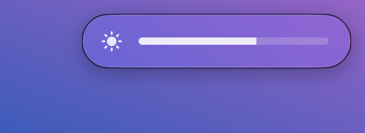
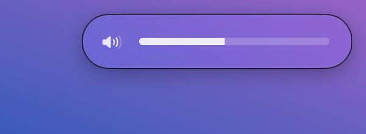

# Touchy

Turn the edges of your MacBook trackpad into brightness and volume sliders.

- **Left edge:** slide one finger up to make the screen brighter, down to dim it.
- **Right edge:** slide one finger up to turn the volume up, down to turn it down.

<p>
  
  
</p>

Touchy lives in the menu bar and stays out of the way. I wanted it to be as light as possible, so it has no dependencies, no settings window and no timers or polling. It does nothing at all until a finger touches the trackpad.

| | |
|---|---|
| App size | ~80 KB |
| Memory when idle | ~12 MB |
| CPU when idle | 0% |
| Permissions needed | None |

## Features

- **Smooth control:** levels follow your finger instead of jumping in 1/16 steps like the keyboard keys.
- **Stays out of your way:** a swipe only counts if one finger lands right on the edge and moves up or down. Clicks, normal cursor moves, horizontal drags and two-finger scrolls are ignored.
- **On-screen level bar:** a small bar in the top-right corner shows the level while you swipe, then fades out. Its window is freed once it's hidden.
- **Unmutes for you:** swiping up on the right edge turns sound back on if it's muted.
- **Launch at login:** turn it on from the menu bar.

## Requirements

- macOS 13 Ventura or later. The level bar uses Liquid Glass on macOS 26 and later.
- A Mac with a built-in trackpad. If there's no built-in trackpad, it uses the first trackpad it finds.
- Brightness only works on the built-in display. Volume works with whatever output device is active.
- Xcode or the Command Line Tools to build it (`xcode-select --install`).

## Install

```sh
git clone https://github.com/GausPeerzade/touchy.git
cd touchy
make install
```

This builds a release version, copies `Touchy.app` to `/Applications` and launches it. A ✋ icon will show up in your menu bar.

Since you build it yourself, macOS won't show the "unidentified developer" warning.

## Usage

1. Put one finger on the far left or far right edge of the trackpad, within about 1 cm.
2. Slide it up or down. Once a swipe has started, your finger can drift off the edge and it keeps working.
3. Lift your finger to stop.

Click the ✋ icon in the menu bar for:

- **Enabled:** pause or resume Touchy.
- **Launch at Login:** start Touchy automatically when you log in.
- **Quit Touchy**

If the icon looks greyed out, Touchy couldn't connect to the trackpad. Toggle **Enabled** off and on again to retry.

## Uninstall

Quit Touchy from the menu bar, then delete `/Applications/Touchy.app`. If you turned on Launch at Login, turn it off first.

## How it works

- **Trackpad input:** raw finger positions come from Apple's private `MultitouchSupport` framework. That's how tools like BetterTouchTool read the trackpad, and it doesn't need Accessibility permission.
- **Brightness** is set through the private `DisplayServices` framework.
- **Volume** is set through CoreAudio on the default output device.
- **Level bar:** recent macOS versions moved the system volume/brightness overlay into Control Center, so Touchy draws its own small one.

Both private frameworks are loaded at runtime with `dlopen`. If a future macOS removes them or their functions, Touchy turns itself off (the icon greys out) instead of crashing.

### Project layout

```
Sources/CPrivate     C shim over the private frameworks
Sources/TouchyCore   Gesture state machine and level logic (pure, unit tested)
Sources/Touchy       Menu bar app, CoreAudio and the level bar
Tests                Tests for the gesture and level logic
```

## Development

```sh
make app      # build build/Touchy.app
make test     # run the tests
make install  # build, install to /Applications and relaunch
make clean
```

## Known limitations

- The cursor still moves while you swipe an edge. Stopping that would need Accessibility permission and code that intercepts every mouse event, which goes against keeping it light.
- Touchy uses private Apple APIs, so a future macOS update could break it. It also can't go on the Mac App Store because of them.

## License

[MIT](LICENSE)
